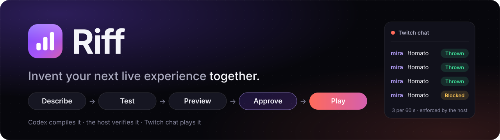
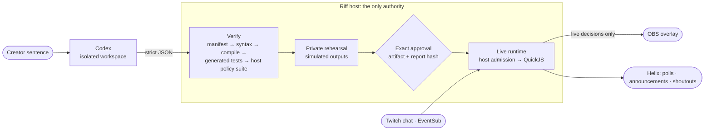

<p align="center">
  
</p>

<p align="center">
  <a href="https://twitchcon-codex.devpost.com/"></a>
  <a href="https://github.com/rogerjeasy/riff/actions/workflows/verify.yml"></a>
  
  
  
  
</p>

<p align="center">
  <strong><a href="#try-it">Try it</a></strong> ·
  <a href="docs/studio-guide.md">Studio guide</a> ·
  <a href="packages/sdk/SDK.md">SDK guide</a> ·
  <a href="docs/project-documentation.md">Product document</a> ·
  <a href="AGENTS.md">Engineering contract</a> ·
  <a href="docs/feature-matrix.md">Feature matrix</a>
</p>

---

## The idea

A joke in chat suggests a tomato fight. A raid suggests a welcome ritual. Streamers come
up with these moments faster than any tool can be configured, so most of them never
happen on stream.

With Riff, the creator configures an interaction by describing it:

> Let viewers throw tomatoes with `!tomato`, limited to three throws per person in any rolling 60 seconds.

Codex compiles that sentence while the stream is running. It produces a handler, a
permission manifest and tests. Riff does not take the result on trust. The host checks
it again in the same sandbox that runs live chat, rehearses it in private, and activates
only the exact version the creator approved. About a minute later, chat is throwing
tomatoes on stream.

## One sentence to stream, in five steps

|              | What Riff does                                                                                                   | What the creator sees                                                              |
| ------------ | ---------------------------------------------------------------------------------------------------------------- | ---------------------------------------------------------------------------------- |
| **Describe** | Takes typed or spoken intent, including edits to a live interaction                                              | Prefilled examples; push-to-talk with an editable transcript                       |
| **Test**     | Codex returns code, a manifest and at least 3 scenarios; the host runs its own 5-stage pipeline and policy suite | _What you asked vs. what will run_, every check, the exact code                    |
| **Preview**  | Runs the same engine with private clocks, state and simulated outputs                                            | A proof sequence: three throws land, the fourth is blocked, duplicates are ignored |
| **Approve**  | Binds approval to the artifact hash, the test-report hash and the live version on screen                         | An authority diff for anything that widens permissions                             |
| **Play**     | Lets real Twitch chat, over EventSub, drive the OBS overlay                                                      | Pause, rollback and **Stop everything**, always one click away                     |

## Try it

**Hosted, nothing to install.** Open the private sign-in link from the Devpost testing
instructions (`https://judge.18-210-118-156.sslip.io`). It keeps you signed in for 30
days. All judges share this instance, and it holds no creator data.

1. Press **Generate** on the prefilled Tomato Toss sentence.
2. Read the evidence, then press **Run proof sequence** on the private stage.
3. **Approve** it, then open the overlay URL in a browser tab or an OBS browser source (1920×1080).
4. Press **Connect Twitch** and type `!tomato` in your own chat.
5. Press **Edit** and ask: _"Change the command to !splat, allow two throws per 30 seconds,
   subscribers only."_ Review the authority diff, approve it, then roll back.

**Locally, no accounts.** Requires Node 22 (`.nvmrc`) and pnpm 12.6.0.

```sh
nvm install && corepack enable && corepack prepare pnpm@12.6.0 --activate
pnpm install --frozen-lockfile
pnpm dev            # server :8787 · console http://localhost:5173 · migrations run at boot
```

No `.env` file is needed. By default Riff uses a deterministic **offline compiler**, and
the UI labels it as such. To compile with Codex at runtime, run `codex login` once and set
`RIFF_COMPILER_MODE=codex` in `.env`. Twitch app setup is in the
[studio guide](docs/studio-guide.md#connecting-twitch).

## What you can build

| Say                                                                             | You get                                                                                   |
| ------------------------------------------------------------------------------- | ----------------------------------------------------------------------------------------- |
| _"Let viewers throw tomatoes with !tomato, three per minute"_                   | **Reactions**: overlay effects with per-viewer rolling limits                             |
| _"Tomato battle: join red or blue, three throws each, two minutes"_             | **Team rounds**: the host keeps scores, resources, the deadline and the winner            |
| _"When 5 different viewers type !shield within 10 seconds, the shield goes up"_ | **Mechanics**: crowd bursts, team health and elimination, best-of-N matches, unlocks      |
| _"Let chat paint an 8x8 mural with !paint"_                                     | **Formats**: a community mural, a staged song vote, a group quiz                          |
| _"Every 10 minutes show a hydration reminder"_                                  | **Timers**: saved to the database, survive restarts, can be cancelled                     |
| _"When we get raided, shout out the raider and show a welcome burst"_           | **Twitch events**: subs, gifts, resubs, cheers, raids, Channel Points, polls, predictions |

Game rules (teams, resources, scores, deadlines) run in the host. Generated code only
reads a frozen snapshot and decides how things look. A full effect budget can delay a
splat, but it can never change who wins.

## The studio around it

|                          |                                                                                                                                                                        |
| ------------------------ | ---------------------------------------------------------------------------------------------------------------------------------------------------------------------- |
| **Live evolution**       | Change the rules mid-round, for example _"keep everyone's scores, give two more throws."_ A reviewed migration keeps progress, or Riff explains why it can't.          |
| **Audience co-creation** | `!riff suggest …` goes to a moderated inbox, then a chat vote, then a brief the creator reviews. Chat never compiles or activates code.                                |
| **Rehearsal studio**     | Seeded, step-through replays of crowd bursts, duplicate deliveries and deadlines. Any failure can be saved as a regression test, and every later version must pass it. |
| **Visual canvas**        | Drag the scoreboard, or type _"move left by 10."_ Camera and captions stay protected.                                                                                  |
| **Shared channels**      | 2–4 creators play one cooperative round, and each approves their own role. Tokens and private state never leave an instance.                                           |
| **Adaptive director**    | Paces effects during chat bursts, within ranges the creator approved. It never changes game rules.                                                                     |
| **Remix**                | Export a licensed recipe. The recipient adapts its command, language and layout, and Riff verifies it again before install.                                            |
| **Production**           | Connectors for OBS, Streamer.bot and Firebot. Imported configurations are read as data and never executed.                                                             |
| **Everyone plays**       | Free chat participation, rules in English, French, Spanish and German, `!riff help` and `!riff language`, reduced motion.                                              |
| **And**                  | Authoring from chat with single-use approval codes, voice input, and insights that only report aggregates.                                                             |

Each feature has a step-by-step walkthrough in the [studio guide](docs/studio-guide.md).

## Codex is the compiler

Codex runs on every Describe and Edit, not only during development.

- **Isolated input.** Each compile starts in a fresh temporary workspace that contains only
  `TASK.md`, `SDK.md`, two `.d.ts` files and curated examples. It also gets a fresh
  `CODEX_HOME` with nothing but the login, a read-only sandbox, and no network, web search,
  repository or credentials.
- **Structured output.** Codex returns a strict JSON Schema object: a candidate, a
  clarifying question, or "unsupported". Riff never parses free text.
- **Bounded repair.** Each compile gets exactly one automatic repair round, using a failure
  report capped at 4 KB. Compiles time out at 180 s, and the queue runs 1 per channel and
  4 in total.

Measured with Codex CLI 0.166.0 through `pnpm compile:live`. Every run below succeeded on
its first attempt, with every stage and intent check passing:

| Request                                                                                               | Time |
| ----------------------------------------------------------------------------------------------------- | ---: |
| Tomato Toss                                                                                           | 39 s |
| Edit: `!splat`, two throws per 30 s, subscribers only                                                 | 63 s |
| Red/blue tomato battle (stateful)                                                                     | 41 s |
| Edit that battle into a `!grow` community goal of 10                                                  | 43 s |
| In production: timer + announcement, compiled, verified (6/6 generated, 6/6 host checks) and approved | 54 s |

## The host never trusts generated code



- **The host decides first.** Command matching, audience rules, per-viewer windows, channel
  budgets and duplicate suppression run before any generated code. Each decision is written
  to SQLite before any effect is sent.
- **A fresh sandbox for every event.** Code runs in QuickJS with 64 MB of memory, 50 ms of
  CPU, 2 s of wall time and 25 bridge calls. It has no network, filesystem, timers, `eval`
  or clock. Any fault quarantines that version.
- **Previews can't leak.** Preview engines have no path to Twitch or the overlay, and the
  overlay broker rejects anything that is not a live decision.
- **Approval is exact.** A stale review returns 409, and changed evidence blocks approval.
- **Stop everything works when other parts fail.** From the console, the OBS dock or
  `!riff panic`, it sets an in-memory stop first, clears the overlay, then saves the stop,
  which holds across restarts.
- **Rounds can be audited.** State, event identity and outgoing effects commit together.
  **Verify round** replays the journal and confirms that it reproduces the live scoreboard.
- **Minimal Twitch access.** Riff asks only to read chat at sign-in. Every other scope is
  requested when its feature is turned on, and tokens are sealed with AES-256-GCM.

## What is real

All 40 features are built: 34 are complete and 6 have documented limits
([feature matrix](docs/feature-matrix.md)). Here is what has run against real services:

|                                                      | Status                                                                                                     |
| ---------------------------------------------------- | ---------------------------------------------------------------------------------------------------------- |
| Codex runtime compile, EventSub chat trigger, timers | **Live** in production on a real channel                                                                   |
| Chat replies, announcements, echo-loop suppression   | **Live**                                                                                                   |
| Shoutouts                                            | The request reached Twitch, which refused it because the channel was offline                               |
| Polls, Channel Points, Predictions                   | Built against Twitch's documented fixtures. Twitch requires Affiliate status, which the test channel lacks |
| Shared channels, OBS / Streamer.bot / Firebot, voice | Tested with real engines, separate databases and protocol fakes. No live multi-creator stream is claimed   |
| Offline compiler                                     | Deterministic templates for CI and demos, labelled in the UI                                               |

## Built with

TypeScript 5 · Node 22 · pnpm workspaces · Fastify 5 · React 19 + Vite + Tailwind 4 ·
SQLite (better-sqlite3 + Drizzle) · zod · quickjs-emscripten · `@openai/codex-sdk` ·
Twitch EventSub WebSocket + Helix · Vitest · Playwright + axe · Terraform → AWS Lightsail

```text
apps/web            Console, private rehearsal stage, OBS dock, read-only overlay
apps/server         Fastify host: authoring queue, verification, approval, live runtime, SQLite
packages/sdk        The contract Codex compiles against (no dependencies)
packages/compiler   Codex output schema, prompt workspace, intent checks, offline compiler
packages/sandbox    QuickJS engine, host admission, static analysis, verification pipeline
packages/twitch     EventSub lifecycle, Helix, OAuth, chat normalization, recorded fixtures
```

Dependencies only point downward, and `pnpm lint` enforces that.

| Command                    | Purpose                                                             |
| -------------------------- | ------------------------------------------------------------------- |
| `pnpm dev`                 | Server and console with hot reload                                  |
| `pnpm check`               | Lint, boundaries, strict types, every test, secret scan             |
| `pnpm test:e2e`            | Chromium end-to-end flow with axe accessibility checks              |
| `pnpm compile:live`        | One real Codex compile (add `--edit "…"`) through the full pipeline |
| `pnpm build && pnpm start` | Production build served on :8787                                    |

Every command is listed in [AGENTS.md §7](AGENTS.md#7-repository-layout-and-commands).
Pushes to `main` that pass CI deploy to AWS Lightsail using Terraform and GitHub OIDC
([infra/deploy](infra/deploy/README.md)).

## Read more

- [Studio guide](docs/studio-guide.md): a walkthrough for every feature
- [SDK guide](packages/sdk/SDK.md): the exact contract Codex compiles against
- [Engineering contract](AGENTS.md): architecture, invariants, security rules
- [Product document](docs/project-documentation.md): the full vision, personas and acceptance scenarios
- [Setup](docs/setup.md) · [Tech stack](docs/tech-stack.md) · [Feature matrix](docs/feature-matrix.md)
