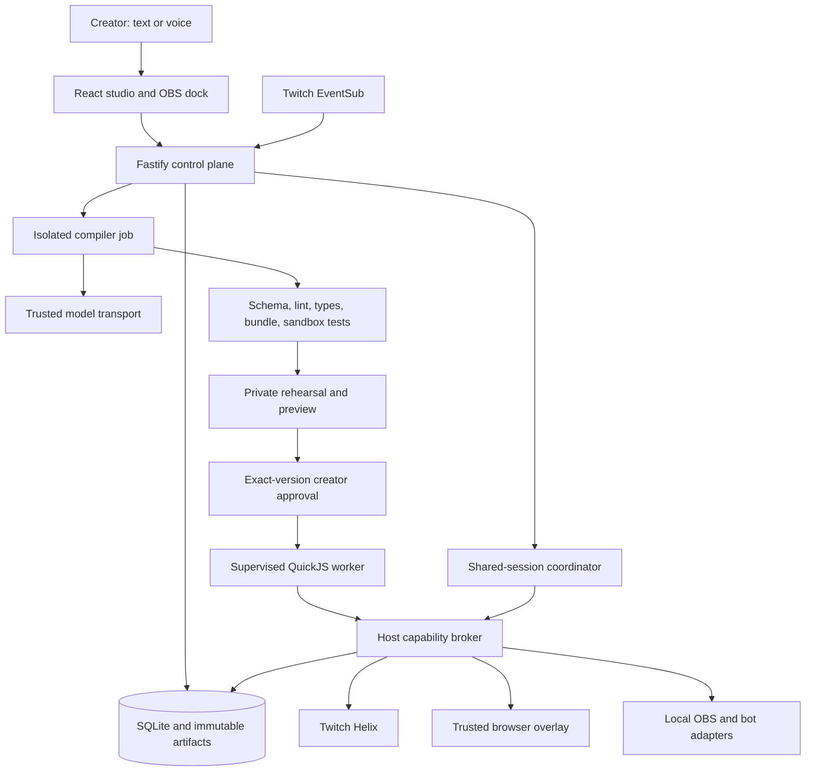

# Riff — Technology stack

| Document field | Value |
| --- | --- |
| Version | 1.0 |
| Prepared | October 31, 2026 |
| Product scope | All features F01–F40 in the [project documentation](project-documentation.md), including the nine studio expansions and inclusive participation |
| Engineering baseline | [Engineering contract](../AGENTS.md) |
| Implementation status | Architecture and technology selections. No application packages, lockfile, infrastructure, or integrations have been installed or deployed yet. |

Riff uses TypeScript throughout, React for the studio, Fastify for the trusted host, SQLite for durable state, and QuickJS for generated automation execution. Codex is the runtime compiler. The host owns permissions, approval, state, network access, and execution limits. The complete product includes stateful experiences, live evolution, audience co-creation, rehearsal, a visual canvas, collaboration across channels, an adaptive director, contextual remix, production integrations, and inclusive participation.

This document records both third-party tools and the Riff-specific systems that must be built. A library installation does not provide those systems automatically. Selection is based on the full product requirements; delivery order follows dependencies and verification, without timeframe-based feature cuts.

**Decision labels:** **Baseline** means already specified in the engineering contract. **Selected** means a supporting technology recommended by this document. **Conditional** means used only in the stated deployment or integration context. These labels describe technology decisions, not implementation progress. Package additions must still follow the repository's dependency justification rule.

## Contents

1. [Stack overview](#1-stack-overview)
2. [Language, runtime, and workspace](#2-language-runtime-and-workspace)
3. [Frontend and interface](#3-frontend-and-interface)
4. [Overlay, visual canvas, and assets](#4-overlay-visual-canvas-and-assets)
5. [Backend, protocols, and authentication](#5-backend-protocols-and-authentication)
6. [Persistence, jobs, and storage](#6-persistence-jobs-and-storage)
7. [Runtime compiler and capability SDK](#7-runtime-compiler-and-capability-sdk)
8. [Generated-code sandbox](#8-generated-code-sandbox)
9. [Experience engine, rehearsal, and live evolution](#9-experience-engine-rehearsal-and-live-evolution)
10. [Twitch integration](#10-twitch-integration)
11. [Voice, language, and accessibility](#11-voice-language-and-accessibility)
12. [OBS and existing automation tools](#12-obs-and-existing-automation-tools)
13. [Collaboration, director, and recipe distribution](#13-collaboration-director-and-recipe-distribution)
14. [Testing and verification](#14-testing-and-verification)
15. [Observability and product analytics](#15-observability-and-product-analytics)
16. [Deployment and operations](#16-deployment-and-operations)
17. [Developer tools and delivery](#17-developer-tools-and-delivery)
18. [Package ownership and dependency inventory](#18-package-ownership-and-dependency-inventory)
19. [Feature coverage](#19-feature-coverage)
20. [Version policy and implementation decisions](#20-version-policy-and-implementation-decisions)
21. [Documentation maintenance](#21-documentation-maintenance)

## 1. Stack overview

| Layer | Technology or tool | Status | Purpose in Riff |
| --- | --- | --- | --- |
| Language | TypeScript 5, ESM | Baseline | Host, UI, public contracts, generated automations, and tests |
| Runtime | Node.js 22 | Baseline | Persistent server, compiler transport, workers, and development tooling |
| Workspace | pnpm workspaces | Baseline | Six application/package workspaces and one reproducible lockfile |
| Studio | React 19, Vite | Baseline | Intent composer, review, rehearsal, canvas, activity, directory, and OBS dock |
| Styling | Tailwind CSS 4 | Baseline | Design tokens, responsive layout, themes, and accessible states |
| Graphics | Canvas 2D, SVG, CSS, Web Animations API | Selected | Trusted effects, scene editing, timing tracks, and overlay composition |
| Server | Fastify 5 | Baseline | HTTP endpoints, authorization, services, and host orchestration |
| Live transport | `@fastify/websocket`, `ws`, browser WebSocket | Baseline / Selected | Console and overlay streams, Twitch EventSub, adapter connections |
| Boundary validation | Zod | Baseline | Runtime validation of external input, model output, messages, and configuration |
| Database | SQLite, `better-sqlite3` | Baseline | Channel data, versions, approvals, sessions, events, timers, jobs, and outbox |
| Data access | Drizzle ORM, Drizzle Kit | Baseline | Typed queries, schema definitions, and reviewed migrations |
| Runtime generation | `@openai/codex-sdk`; official CLI fallback | Baseline | Produce and revise TypeScript, generated tests, manifests, and experience definitions |
| Automation build | TypeScript compiler, ESLint, esbuild | Baseline | Validate and bundle restricted generated code |
| Execution | `quickjs-emscripten` | Baseline | WASM-hosted JavaScript runtime behind Riff's capability bridge |
| Experience systems | Riff-owned TypeScript services | Selected | Canonical definitions, state machines, migration, replay, director, and collaboration |
| Twitch | OAuth 2.0, Helix REST, EventSub WebSocket | Baseline | Identity, chat/events, channel actions, and consent |
| Voice input | MediaRecorder, OpenAI transcription API, `openai` | Selected | Push-to-talk capture and editable transcript |
| Streaming production | OBS Studio, OBS WebSocket v5, `obs-websocket-js` | Selected | Browser source, dock, authorized source discovery and setup |
| Existing bot bridge | Streamer.bot WebSocket API; versioned import adapters | Selected | Explicitly mapped events/actions and configuration import |
| Host tests | Vitest, MSW, Fastify injection | Baseline | Unit, service, route, and integration checks |
| UI and system tests | Playwright, Testing Library, axe-core | Selected | Browser journeys, accessibility, rendering, and regression evidence |
| Property tests | `fast-check` | Selected | Invariants across event sequences, state transitions, and rate windows |
| Logs | Fastify/Pino; `pino-pretty` for development | Selected | Structured, redacted operational evidence |
| Metrics | `prom-client`; Prometheus and Grafana when operated remotely | Selected / Conditional | Runtime and compiler health, dashboards, and alerts |
| Packaging | Docker Engine, Docker Compose | Selected | Reproducible Linux deployment and process separation |
| Public ingress | Caddy | Conditional | HTTPS and WebSocket reverse proxy for a hosted instance |
| Stronger hosted isolation | gVisor `runsc` | Conditional | Additional isolation for untrusted execution in public multi-tenant hosting |
| Backups | SQLite consistent snapshots, restic | Selected | Recoverable encrypted backups with restore checks |
| Delivery | Git, GitHub, GitHub Actions, GHCR | Selected | Source review, CI, release images, and evidence artifacts |
| Quality and security | ESLint 9, `typescript-eslint`, Prettier, Gitleaks, pnpm audit, Trivy | Baseline / Selected | Static checks, formatting, secret detection, and dependency/image review |

The arrows show logical responsibilities. Model access, guest execution, public overlays, local production connections, and private preview each have distinct authorization and isolation boundaries.

## 2. Language, runtime, and workspace

### 2.1 TypeScript and Node

Use TypeScript 5 with `strict`, `noUncheckedIndexedAccess`, and `exactOptionalPropertyTypes`. Use ESM across the workspace. Generated automation code targets the deliberately smaller Riff SDK and the JavaScript features supported by the pinned QuickJS build.

Retain Node.js 22 as the engineering baseline and use a supported, patched release. The current Vite guide requires Node 20.19+ or 22.12+; therefore the Node 22 baseline must be **at least 22.12**, subject to any higher minimum required by the chosen dependency set. Pin the exact runtime after compatibility checks rather than using a floating image tag. [Vite requirements](https://vite.dev/guide/), [Node release status](https://nodejs.org/en/about/previous-releases).

Use built-in Node APIs where they fit: `fetch` and `AbortController` for HTTP, `node:crypto` for identifiers/hashes/encryption, `node:fs` for controlled host storage, and `node:child_process` for supervised workers. None of these APIs is exposed to generated code.

### 2.2 Workspace and build

Use pnpm workspaces with one committed `pnpm-lock.yaml` and a pinned `packageManager` field. Keep TypeScript project references and build order explicit. `tsx` is selected for trusted development scripts and server development; production runs compiled JavaScript.

Vite builds the browser applications. esbuild separately builds restricted automation artifacts. These are distinct build pipelines: the current Vite documentation describes Rolldown as its production bundler, so Riff must not assume that Vite's internal bundler is esbuild. [Vite architecture](https://vite.dev/guide/).

The six existing workspace boundaries remain:

| Workspace | Ownership |
| --- | --- |
| `apps/web` | Console, canvas, rehearsal interface, overlay entry, and dock |
| `apps/server` | Network transports, service orchestration, authorization, database, workers, and production adapters |
| `packages/sdk` | Dependency-free public types, policy constants, declaration files, examples, and generated SDK documentation |
| `packages/compiler` | Generation contracts, prompt construction, artifact validation, bounded repair, and injected transport interfaces |
| `packages/sandbox` | QuickJS lifecycle, JSON bridge, guest runner, simulated sinks, and execution limits |
| `packages/twitch` | OAuth, Helix, EventSub, trigger definitions, and sourced fixtures |

## 3. Frontend and interface

### 3.1 React studio

Use `react`, `react-dom`, `vite`, and `@vitejs/plugin-react`. React renders the intent composer, compilation progress, behavior card, permission diff, approvals, activity, proposal moderation, session controls, recipe directory, and remix flows.

Use React reducers and context for local interface state. Keep authoritative session state in the server. HTTP retrieves snapshots and performs authenticated commands; WebSocket messages provide versioned updates. Reconnection requests a fresh snapshot or resumes from a verified sequence cursor. A client display must never independently decide that an automation is approved or that a competitive contribution was accepted.

Use the browser URL and History APIs for the initial route set. Keep navigation handling in one tested module. A separate routing or client state framework is unnecessary for the defined architecture; reassess only when concrete navigation or synchronization requirements justify it.

### 3.2 Styling and component system

Use `tailwindcss` and `@tailwindcss/vite` with CSS custom properties for colors, typography, spacing, focus, density, and motion. Build a small Riff component set from semantic HTML: buttons, fields, dialogs, tabs, status indicators, permission lists, timelines, and tables. Each component must cover pending, disabled, failure, keyboard, and reduced-motion behavior. [Tailwind Vite integration](https://tailwindcss.com/docs/installation/using-vite).

Use native form controls where appropriate. Complex interactions need explicit keyboard equivalents and screen-reader descriptions. Keep iconography in owned SVG assets. Theme selection and channel branding modify approved tokens, not arbitrary creator-supplied CSS.

### 3.3 Browser surfaces

| Surface | Rendering and delivery |
| --- | --- |
| Main console | React application with authenticated owner/moderator sessions |
| Visual canvas | React controls surrounding a trusted SVG/Canvas scene editor |
| Rehearsal | React timeline and inspectors connected to an isolated replay session |
| Public overlay | Separate Vite entry and bundle; transparent page; trusted effects only |
| Private preview | Separate preview identity and transport; cannot publish into the live overlay |
| OBS dock | Compact console entry using the same authenticated services and state model |
| Mobile creator controls | Responsive console with explicit touch targets and low-motion feedback |

The overlay has no interactive login screen, but its rotatable bearer key still authorizes its connection. Keep owner controls and credentials out of its bundle. Verify bundle separation from Vite's generated manifest and built assets; do not assume an undocumented reporting flag exists.

## 4. Overlay, visual canvas, and assets

### 4.1 Trusted renderer

Use Canvas 2D for bounded particles and projectile effects, SVG for editor handles and spatial regions, and DOM/CSS for text, instructions, and semantic controls. Use `requestAnimationFrame`, CSS transforms, and the Web Animations API for presentation. The host supplies a normalized scene and effect commands; generated code never supplies executable renderer code or raw HTML.

Use a fixed logical scene coordinate system, with responsive scaling and protected regions. The canonical scene includes stable object IDs, layers, positions, approved asset references, timing, visibility rules, and accessible alternatives. Pointer Events handle drag/resize interaction; the keyboard changes the same properties through equivalent commands.

A target of 60 fps at a 1920×1080 scene is a **measurement target**, not a verified capability. Enforce particle, text, animation, and payload budgets; collect frame timing; degrade cosmetic density without deleting accepted gameplay contributions.

### 4.2 Canvas and timeline engine

Build a Riff-owned scene command model in TypeScript. Text edits, canvas edits, and timing-track edits change the same canonical experience definition. Commands carry an expected revision so stale edits are rejected visibly. Undo/redo applies to the draft command history; it does not undo external Twitch actions.

Changes inside an approved presentation range create a configuration revision. Changes to behavior, authority, participant rules, or state schema follow the version validation and approval pipeline. The director cannot use a visual control to bypass this distinction.

### 4.3 Assets and design tools

Store bundled fonts, SVG, images, and effects under version control, with ownership/license metadata. Serve runtime assets from Riff's origin. Imported recipes refer to approved content hashes; remote arbitrary URLs and active SVG/HTML are rejected or converted through a controlled ingestion path.

Figma is an **optional design collaboration tool**, with the implementation and design tokens remaining authoritative in the repository. OBS Studio captures stage/video evidence. No paid design account is required to build or run Riff.

## 5. Backend, protocols, and authentication

### 5.1 Fastify services

Use Fastify 5 with small route handlers that parse, authorize, and call services. The service layer owns compilation, approval, execution, session transitions, proposals, recipes, and integrations. Inject transport and persistence dependencies so host behavior can be tested without live credentials.

The selected supporting plugins below belong to Fastify's ecosystem; choose releases whose compatibility tables explicitly support Fastify 5. [Fastify plugin registry](https://fastify.dev/ecosystem/).

| Package | Purpose |
| --- | --- |
| `@fastify/websocket` | Authenticated console, overlay, dock, and private preview streams |
| `@fastify/cookie` | Signed cookie parsing and serialization |
| `@fastify/session` | Opaque server-side sessions with a Riff SQLite-backed store |
| `@fastify/csrf-protection` | CSRF protection for cookie-authenticated mutations |
| `@fastify/helmet` | Security headers, including surface-specific content security policies |
| `@fastify/rate-limit` | HTTP abuse limits; separate from automation/gameplay quotas |
| `@fastify/static` | Serve built console/overlay assets from the application origin |
| `@fastify/multipart` | Bounded voice and asset upload handling |
| `ws` | Outbound EventSub/adapter connections and test WebSocket servers |

Keep production same-origin where possible. Configure allowed origins explicitly for any development split origin. The default in-memory session store is not a production persistence strategy.

### 5.2 API contracts

Use JSON over HTTP for commands and snapshots, and versioned JSON over WebSocket for live updates. Every message carries the relevant channel/session identity, message kind, protocol version, and sequence or revision. Zod validates inbound and outbound boundaries in the trusted host; browser decoders validate the messages they consume.

Define host-owned schema modules and generate dependency-free public protocol types/JSON Schema artifacts as needed. Do not put a Zod runtime dependency or an import from `packages/sandbox` into `packages/sdk`. Dependency-free SDK policy constants define public maxima; the host owns Zod schemas and stricter operational enforcement.

Use optimistic concurrency for edits, idempotency keys for repeatable local commands, and typed user-safe error codes. Reconnection does not imply that missed side effects should be replayed indiscriminately.

### 5.3 Identity and authorization

Twitch OAuth identifies creators. Persist app sessions separately from encrypted OAuth tokens. Use HttpOnly cookies, SameSite policy, production Secure cookies, CSRF defenses, and WebSocket origin validation. OAuth callbacks use validated, single-use state and the chosen Twitch-supported flow.

Riff's own authorization service grants owner, limited moderator, collaborator, and overlay-view privileges. Twitch moderator status alone does not grant code activation. Approval binds the actor, channel, artifact hashes, SDK/manifest versions, and verification report.

Use `node:crypto` for cryptographically random identifiers, SHA-256 artifact hashes, and AES-256-GCM token encryption. Keep encryption keys outside the database. Hash possession is evidence of identity/integrity, not proof of publisher trust or code safety.

## 6. Persistence, jobs, and storage

### 6.1 SQLite and Drizzle

Use SQLite through `better-sqlite3`, Drizzle ORM for typed data access, and Drizzle Kit for reviewed migrations. Drizzle documents `better-sqlite3` as a supported SQLite driver. Select a mutually compatible **stable** ORM/Kit pair; documentation examples that use release candidates do not mandate adopting them. [Drizzle SQLite support](https://orm.drizzle.team/docs/sqlite/get-started-sqlite).

Enable foreign keys, use WAL where appropriate, keep write transactions short, and set explicit busy handling. Store the database on a local durable volume. SQLite's single-writer behavior is a capacity constraint to measure; do not put a shared database file on a network filesystem and treat it as a distributed database.

`better-sqlite3` is a native Node dependency. Its build/runtime ABI and container architecture must match. Keep synchronous database work bounded so it cannot undermine control responsiveness; heavy export, compaction, and backup work belongs off the request path.

### 6.2 Persistent domains

| Domain | Stored information |
| --- | --- |
| Channels and identity | Accounts, OAuth metadata/ciphertext, app sessions, grants, overlay keys |
| Automations | Source, test source, manifests, SDK versions, immutable artifact hashes, approvals |
| Compilation | Jobs, attempts, stage reports, redacted trace references, timings, usage when exposed |
| Execution | Normalized events, deduplication records, decisions, bounded diagnostics, incidents |
| Sessions | Participants, rounds, resources, state revisions, snapshots, migrations, transition records |
| Scheduling | Durable timers, job status, cancellation, dispatch fences, transactional outbox |
| Studio | Scene drafts, approved revisions, scenario definitions, rehearsal runs and counterexamples |
| Community | Proposals, moderation actions, ballots, creator selection, attribution |
| Collaboration | Membership, grants, coordinator ownership, shared public projections, consent changes |
| Distribution | Recipes, immutable versions, license/provenance, install records, compatibility metadata |
| Insights | Aggregated participation, engagement, failure, latency, and budget statistics |

Channel-private repositories always require channel scope. Shared-session data uses a dedicated membership-aware repository; it never grants unrestricted queries across channels.

### 6.3 Durable jobs, timers, and effects

Build bounded TypeScript job queues backed by SQLite. Compilation admission is one job per channel and four global as the initial configured limit. Persist status, cancellation, attempt count, and leases/fences. Stale jobs after a crash become visible failures or resumable work according to the job type.

Use a transactional outbox to commit accepted state transitions and intended effects together. Dispatch externally after commit. Track uncertain external outcomes explicitly; a database transaction cannot make a remote Twitch action exactly-once. Quotas, role checks, and activation fences are rechecked at dispatch.

Timers store logical deadlines and restart policy. Host scheduling emits normalized internal events. Preview and rehearsal use virtual time and separate storage. No guest receives a native timer or direct access to queue infrastructure.

### 6.4 Artifacts and backup

Store immutable bundles, imported safe assets, and verification evidence in a content-addressed directory; keep metadata and references in SQLite. Use atomic publication and orphan cleanup. Recipe exports use a validated JSON package with bounded attachments/references, never credentials.

Use SQLite's supported backup mechanisms to create a consistent snapshot before restic archives it with the relevant immutable assets and metadata. Test recovery with a separate instance and paused automations. Copying only the live database file while WAL is active is not a sufficient backup procedure. [SQLite backup API](https://sqlite.org/backup.html), [restic documentation](https://restic.readthedocs.io/en/stable/).

An S3-compatible object store is conditional for hosted artifact/backup storage. The storage adapter may be introduced when retention, sharing, and operations require it; no provider or paid account is selected here.

## 7. Runtime compiler and capability SDK

### 7.1 Compiler integration

Use `@openai/codex-sdk` as the primary runtime compiler driver and official `codex exec` as the fallback. The official non-interactive interface supports structured JSON event output and output-schema constraints. Pin the SDK/CLI combination and verify its installed documentation before wiring options. [SDK documentation](https://learn.chatgpt.com/docs/codex-sdk), [non-interactive execution](https://learn.chatgpt.com/docs/non-interactive-mode).

`apps/server` owns the network-capable driver. `packages/compiler` receives an injected transport, validates results, and orchestrates the pipeline. The compiler receives the approved request, relevant canonical definition, declaration files, public SDK documentation, and bounded examples. It does not receive OAuth tokens, channel secrets, or unrestricted repository access.

Use a configurable supported compiler model and record the actual model identifier when available. Maintain a benchmark set of meaningful novel requests and edits, measuring correctness, latency, cost, and repair rate. Do not hard-code an unverified model name or equate success on canned prompts with general competence.

### 7.2 Artifact pipeline

| Stage | Tool or system | Required result |
| --- | --- | --- |
| Request validation | Zod and authorization service | Bounded, authorized intent with explicit unresolved questions |
| Generation | SDK/CLI driver | Structured files and experience metadata, or a clarification response |
| Manifest validation | Host Zod schema and policy constants | Supported capabilities and bounded parameters |
| Restricted static checks | ESLint 9, `typescript-eslint`, TypeScript AST checks | Only permitted imports/syntax and bounded literal structures |
| Type checking | TypeScript compiler against Riff declarations | No dependency on Node, DOM, or unapproved packages |
| Bundle | esbuild | Reviewed IIFE/ES2020 artifact with trusted resolution of `riff` |
| Generated tests | Custom QuickJS runner | At least happy path, limit/role edge, and unrelated-event cases |
| Independent verification | Host invariant and scenario suites | Permissions, rate windows, isolation, migration, and replay checks |
| Preview | Rehearsal service plus trusted renderer | Private, inspectable outcomes and permission/behavior diff |
| Approval | Artifact hashing and authorization service | Approval of the exact validated version |

Leaving `riff` external in esbuild is only one step: the trusted linker supplies precisely the approved bridge inside QuickJS. A Node-style unrestricted `require` function must never be added to make the bundle run.

Allow one automatic repair round with a bounded diagnostic report. Enforce total timeout, concurrency, cancellation, and budget in the host. Preserve the active approved version when a candidate fails.

### 7.3 SDK and documentation tooling

`packages/sdk` contains dependency-free types/constants and generated declaration/documentation artifacts. Use the TypeScript compiler API and a small trusted documentation generator to produce the compiler-facing SDK reference. Check capability names against the manifest schema and host bridge in an integration test owned by a downstream package, preserving the dependency direction.

The experience contract versions behavior, state schema, scene/timeline, participant rules, director envelope, test scenarios, and provenance together. Persist canonical serialized artifacts and their hashes so review, rehearsal, and live execution refer to the same version.

## 8. Generated-code sandbox

### 8.1 QuickJS runtime

Use `quickjs-emscripten` in supervised host workers. The library exposes runtime memory/stack limits, interruption hooks, and controllable module loading; its handles require explicit disposal. Riff must build the permission broker, deterministic API, isolation policy, and verification around those primitives. [QuickJS wrapper documentation](https://github.com/justjake/quickjs-emscripten).

One live runtime belongs to one channel and automation version. Each handler invocation uses a **fresh execution context and module instance**, disposed afterward. Persist meaningful state through the host API; neither closures nor module globals may carry behavior across events. Preview, generated tests, rehearsal, and migrations receive separate fresh runtimes and separate host stores/sinks.

The guest receives only validated JSON and capability handles. Restrict imports to `riff` and test-only `riff/test`. Remove or deny network, filesystem, ambient clocks/randomness, dynamic code construction, native timers, and arbitrary module resolution. Lint is an early filter; runtime restrictions and hostile probes provide the actual enforcement evidence.

### 8.2 Resource and authority controls

| Control | Initial target or rule | Enforcer |
| --- | --- | --- |
| Guest heap | 64 MB per runtime | QuickJS runtime limit |
| Handler computation | Approximately 50 ms execution deadline | QuickJS interrupt hook using a trusted monotonic deadline |
| Handler wall timeout | 2 seconds | Independent supervisor |
| Bridge calls | 25 per event | Capability broker |
| Automation state | 1 MB serialized baseline | Validating host store |
| Effect authority | Manifest, local grant, automation limit, channel budget, host cap | Broker before acceptance and dispatch |
| Compile duration | 180 seconds initially | Compiler job supervisor |
| Compile admission | 1 per channel, 4 global initially | Durable admission service |

An interrupt deadline is not precise operating-system CPU accounting. Benchmark and test both computation interruption and supervisor termination. Expected cooldown rejection is a normal decision; a trap, authority violation, or resource exhaustion creates an incident according to policy.

### 8.3 Process and compiler isolation

Keep the control plane independent from execution workers. Child processes provide scheduling/fault separation; they are not by themselves a security sandbox. Run untrusted work with restricted filesystem mounts, environment, networking, and resources. The panic path blocks dispatch immediately before persistence and remains usable when a worker stalls.

The compiler's model transport necessarily needs approved network access. Generated tools/code must not inherit general network egress or model credentials. A temporary working directory only changes location; actual filesystem isolation must deny reads outside the approved workspace. Verify this with read-denial and network-denial canaries.

Docker isolation is selected for reproducible Linux execution. For publicly hosted multi-tenant untrusted work, gVisor is the selected additional isolation candidate, subject to compatibility and escape testing before opening that deployment mode. Restrict network independently; adding gVisor does not automatically implement an egress policy. [Docker security model](https://docs.docker.com/engine/security/), [gVisor documentation](https://gvisor.dev/docs/).

## 9. Experience engine, rehearsal, and live evolution

These are Riff-owned TypeScript systems built on the selected stack. They are central product engineering work, not features supplied by the database or model SDK.

| System | Implementation | Key contract |
| --- | --- | --- |
| Canonical experience model | Versioned JSON plus dependency-free TypeScript types and host Zod schemas | One representation for text, canvas, timeline, tests, and approval |
| Stateful experience engine | Host state machine, SQLite transactions, QuickJS behavior handlers | Participants, resources, phases, rounds, objectives, and outcomes |
| Event journal | Normalized ordered events with provenance and recorded observations | Replay identifies what the host actually knew at each step |
| Randomness | Versioned deterministic PRNG implementation with stored seed and cursor | Replay continues from the exact random position |
| Logical clock | Host-owned clock interface with live and virtual implementations | Timers and time-based rules are reproducible |
| Snapshot engine | State, timer queue, relevant quota state, PRNG cursor, and event cursor | Scrubbing reconstructs a valid session boundary |
| Rehearsal runner | Same bundle and broker validation, isolated stores and simulated sinks | No live chat, overlay, adapter, timer, or collaboration effects |
| Counterexample store | Persisted failing event sequence, artifact identity, seed, and initial snapshot | A discovered failure becomes a repeatable regression case |
| Semantic diff | Riff comparison of permissions, behavior/state schema, scene, and participant rules | Explain consequences beyond a source-code diff |
| Migration runner | Bounded effect-free QuickJS context and host state validator | Validate against current state at the approved transition boundary |
| Activation coordinator | Transactional revision/fence switch | Old and new versions cannot both accept the same transition |

Record event-time role, language, preference, and other host observations required by the behavior; replay must not silently query their present-day values. Network responses and presentation results are captured/simulated rather than reissued. Renderer assets and versions are part of the replay identity; pixel-perfect results across different GPU/browser versions are not assumed.

Rollback checks compatibility with current progress. If the old version cannot read current state, require a tested reverse migration or an explicit reset choice. A historical code artifact is not sufficient to restore a stateful live experience safely.

## 10. Twitch integration

### 10.1 Transport and authentication

Use direct typed Helix HTTP clients with Node `fetch`, Zod response validation, and sourced fixtures. Use EventSub WebSocket through `ws` for inbound events. The long-running host owns both connections and OAuth refresh. [Twitch EventSub](https://dev.twitch.tv/docs/eventsub/), [Helix reference](https://dev.twitch.tv/docs/api/reference/).

Request scopes incrementally for the capabilities the channel enables. Validate stored tokens at startup and on the schedule required by Twitch; handle revoked consent and refresh failure visibly. Check endpoint token type, scopes, channel eligibility, and actor relationship before offering an action. [OAuth scopes](https://dev.twitch.tv/docs/authentication/scopes/), [token validation](https://dev.twitch.tv/docs/authentication/validate-tokens/).

### 10.2 Capability surface

| Capability | Platform mechanism | Riff adapter responsibilities |
| --- | --- | --- |
| Chat commands and audience input | EventSub chat messages | Sender identity, channel origin, command parsing, role checks, and deduplication |
| Send chat | Helix Send Chat Message | Sender/channel authorization, rate budget, and Shared Chat routing policy |
| Subs, gifts, cheers, raids | Appropriate versioned EventSub subscriptions | Normalize only supported payloads; preserve anonymity and event provenance |
| Channel Points | Reward/redemption endpoints and EventSub | Ownership constraints, redemption state, and explicit authorized outcomes |
| Polls | Helix Polls and related events | Eligibility, duration/options, lifecycle, and conflicts with existing polls |
| Predictions | Helix Predictions and related events | Lifecycle and explicit human-authorized outcome policy |
| Announcements and shoutouts | Helix endpoints | Scope/role checks, target allowlist, cooldowns, and visible rejection reasons |

Maintain a versioned trigger/endpoint/scope table in `packages/twitch`, with links to official specifications and redacted real or documentation-sourced fixtures. The adapter owns platform rate limits; generated code only sees Riff capabilities. [Subscription types](https://dev.twitch.tv/docs/eventsub/eventsub-subscription-types/), [EventSub payloads](https://dev.twitch.tv/docs/eventsub/eventsub-reference/).

Handle Twitch-directed `session_reconnect` by transferring the connection with existing subscriptions; an unexpected disconnect requires a fresh session and resubscription. Preserve deduplication across reconnects. [WebSocket lifecycle](https://dev.twitch.tv/docs/eventsub/handling-websocket-events/).

Shared Chat requires explicit origin and message-routing rules. In particular, user-token chat sends cannot rely on app-token-only source-channel controls. Verify the supported behavior for the actual authentication mode and expose limitations before activation. Riff collaboration does not automatically grant permission to broadcast into another channel.

## 11. Voice, language, and accessibility

### 11.1 Push-to-talk authoring

Use browser `getUserMedia` and `MediaRecorder` to capture a bounded recording after the creator chooses voice input. Upload to the authenticated host with format/size/duration checks. Use the official `openai` Node SDK for transcription, separate from the runtime compiler SDK. The creator reviews and edits the transcript before compilation.

Use the current file-transcription workflow, with the model selected through configuration. At the research date, official documentation identifies `gpt-transcribe` in that workflow and marks several older transcription models as deprecated. Verify account access and supported input before pinning the implementation; retain text entry on capture, permission, network, or transcription failure. [Current transcription documentation](https://developers.openai.com/api/docs/guides/speech-to-text).

Do not retain raw audio by default after transcription. Record only necessary operational metadata and the creator-approved text. An additional live conversational voice service is not required for push-to-talk authoring.

### 11.2 Localization and accessible participation

Use UTF-8, explicit locale identifiers, the browser/Node `Intl` APIs, and versioned JSON translation catalogs. Store a viewer's chosen language when consent and identity permit; otherwise use the channel default. Approved message templates and translations are part of the experience version. Do not infer language from names or nationality.

Use semantic HTML, keyboard commands, visible focus, live-region announcements for meaningful state changes, adequate contrast, text alternatives, and `prefers-reduced-motion`. The canvas offers numerical/property editing and a navigable scene list. The overlay communicates objectives and accepted actions with labels and readable timing; color and motion are not the sole signals.

Free chat input, late-arrival instructions, language choice, and fair admission are enforced in the host experience policy as well as the interface. Accessibility cannot be delegated entirely to a component library or automated scan.

## 12. OBS and existing automation tools

### 12.1 OBS production integration

Use OBS Studio browser sources for the overlay and a custom browser dock for creator controls. Use `obs-websocket-js` against OBS WebSocket v5 for approved discovery and setup operations. OBS includes its WebSocket server in modern releases; keep authentication enabled. [OBS remote-control guide](https://obsproject.com/kb/remote-control-guide), [JavaScript client](https://github.com/obs-websocket-community-projects/obs-websocket-js).

The host adapter may discover approved scenes/sources, attach the Riff browser source, adjust declared properties, and invoke explicitly granted operations. Credentials stay in the host. Use stable target mappings and show the proposed production change before execution; arbitrary OBS commands are not exposed as a generic guest capability.

For a local Riff host, the adapter connects locally. A remote Riff host needs a small authenticated **local relay** running near OBS, with an outbound connection to Riff. Bind relay messages to the channel, device, operation allowlist, and expiration. A cloud server cannot reach the creator's `localhost` by using the same address.

### 12.2 Streamer.bot and Firebot interoperability

Use Streamer.bot's documented WebSocket request/event API through the host connection layer, including its supported authentication. Map selected external events and named actions to explicit Riff contracts. [Streamer.bot WebSocket API](https://docs.streamer.bot/api/websocket).

For Firebot and import formats, build version-specific adapters only after inspecting the target release's official schema/protocol. Firebot interoperability remains in product scope, but its exact live connector transport is an **open implementation decision**, not assumed to match Streamer.bot. [Firebot project](https://firebot.app/).

Configuration imports parse data and present supported mappings. Unknown actions remain visible and disabled. Imported C#, JavaScript, shell commands, arbitrary plugins, or other executable payloads never run automatically. Add origin ID, causal ID, hop count, and idempotency records to bridge messages to stop echo loops and duplicate effects.

### 12.3 Real production verification

Playwright verifies the web surface; real OBS tests verify the embedded browser, source settings, transparency, audio/motion behavior when present, and dock authentication. The browser engine shipped with the target OBS release is a compatibility target of its own. Record supported OBS/adapter versions with each release.

## 13. Collaboration, director, and recipe distribution

### 13.1 Audience co-creation

Build proposal ingestion, moderation, shortlisting, ballots, creator selection, and attribution as host services with SQLite persistence. Use existing EventSub chat input and authenticated console commands. Quotas and vote accounting are host-owned; proposals cannot spend compilation budget or activate code without the authorized creator's decision.

Treat community content as untrusted input, including content embedded in a compiler brief. Riff moderation controls its own presentation surfaces. A proposal already posted in Twitch chat is already public there.

### 13.2 Shared experiences

Use a single authoritative coordinator for each shared session, with ordered inputs, coordinator fences, explicit channel membership, and consented public projections. Run shared behavior in a separate coordinator-owned sandbox. Each receiving channel's broker independently authorizes its effects and retains local stop control.

The first topology can coordinate multiple authorized channels on one host. Cross-instance federation requires a versioned authenticated transport and deployment-specific identity before it is enabled. Shared objectives do not require sharing private stores, credentials, or guest heaps. Required-member loss pauses the session according to its agreed policy.

### 13.3 Adaptive director

Implement the director as a deterministic, inspectable TypeScript policy engine over measured activity. It adjusts approved cosmetic density, batching, timing, interruption rate, and other parameters inside the version's explicit envelope. Persist the observation, decision, reason, and applied revision.

A model may help author a proposed policy, but live policy execution must remain bounded and reproducible. Competitive admission, resource allocation, or game-rule changes follow approved rules and the live migration/version process. No additional per-event model call is required for normal operation.

### 13.4 Contextual remix and distribution

Use SQLite metadata/search initially, immutable recipe versions, content hashes, and validated JSON packaging. Add SQLite FTS5 through an explicit migration when full-text discovery is needed and verify its availability in the distributed build. Creator-owned asset/license metadata travels with the recipe.

Remix combines the existing canonical model, channel preferences, layout constraints, available capabilities, and compiler pipeline. The result gets a new version, provenance link, capability/semantic diff, local tests, preview, and recipient approval. Importing a recipe never imports the publisher's tokens, private logs, or activation authority.

Public hosting adds report/moderation workflows, rate limits, quotas, and abuse handling. Directory scale or remote asset volume may justify separate search/object-storage infrastructure later; all present feature contracts can be built without choosing those services prematurely.

## 14. Testing and verification

### 14.1 Test tools

| Tool | Scope | Why it is selected |
| --- | --- | --- |
| Vitest | Trusted host code, policies, contracts, and service tests | Existing baseline; fast TypeScript feedback |
| Custom QuickJS test runner | Compiler-generated tests and automation examples | Executes untrusted code under the same capability restrictions as production |
| MSW | Helix/model HTTP fixtures in trusted tests | Repeatable success, rejection, timeout, and rate-limit scenarios |
| `ws` test server | EventSub and adapter lifecycle tests | Reconnection, malformed frames, revocation, and duplicate delivery |
| Fastify `inject` | HTTP authorization, validation, and session routes | Exercise application routing without an external server |
| `@testing-library/react`, `@testing-library/user-event`, `jsdom` | Trusted component behavior | Keyboard, focus, forms, and user-observable state transitions |
| `@playwright/test` | End-to-end browser flows and visual comparisons | Approval, overlay, canvas, rehearsal, reconnect, and device layouts |
| `@axe-core/playwright` | Automated accessibility checks | Detect common accessibility failures within browser journeys |
| `fast-check` | Property and state-transition tests | Generate event sequences and retain minimized failures |
| Real OBS and authorized Twitch channels | Production integration smoke tests | Validate behavior that mocks and generic browsers cannot establish |

Playwright documents axe-core integration and its limits; manual keyboard/screen-reader evaluation remains necessary. `fast-check` supports property testing with Vitest and other runners. [Playwright accessibility testing](https://playwright.dev/docs/accessibility-testing), [fast-check documentation](https://fast-check.dev/).

Never import generated automation/test files into host Vitest, jsdom, Node, or a browser script tag. Host tests may send them as data into the sandbox runner.

### 14.2 Required evidence

Build suites for all A01–A36 product acceptance scenarios. Include hostile guest code, missing/expired authority, duplicate delivery, timer recovery, panic responsiveness, cross-channel access denial, deterministic replay, current-state migration, canvas/text consistency, director fairness, and bridge feedback loops.

Measure host event-loop delay, queue age, handler interruption, overlay frame performance, generation stages, and end-to-end event latency with bounded load scenarios. Use retained fixtures and labeled synthetic scenarios. Synthetic tests do not prove live platform behavior or arbitrary scale.

External compiler/Twitch tests are explicit opt-in runs with authorized test accounts and spend limits. Normal CI uses recorded, redacted responses. Generated tests contribute evidence but do not replace independent host checks.

## 15. Observability and product analytics

### 15.1 Logs and incidents

Use Fastify's Pino integration for structured JSON logging, with `pino-pretty` only in development. Include correlation IDs for request, compile job, automation version, session, event, and effect. Apply one redaction policy before console output, database persistence, or artifact export. [Fastify logging](https://fastify.dev/docs/latest/Reference/Logging/).

Never log tokens, cookies, overlay bearer URLs, full private audio, or unbounded viewer text. The activity feed uses bounded domain records with user-readable reasons; stack traces and sensitive transport diagnostics stay in restricted operational logs.

### 15.2 Metrics and analytics

Use `prom-client` for host metrics. A private metrics endpoint feeds Prometheus and Grafana in a remotely operated deployment. Keep label cardinality bounded: user IDs, raw prompts, recipe text, and unbounded session IDs are not metric labels. [Prometheus Node client](https://github.com/prometheus/client_js).

Track compiler queue/stage latency, validation and repair outcomes, worker traps, denied effects, EventSub health, token-refresh failures, outbox age, database contention, director adjustments, and overlay performance. Alerts identify actions an operator can take, such as pausing a failing adapter or inspecting a stuck queue.

Compute product insights from bounded event summaries in SQLite: time to first approved interaction, unique participation, proposal-to-selection conversion, remix adoption, successful independent creator operation, and accessibility failures. Apply retention/deletion policies and avoid spend-based viewer rankings. An external product analytics SaaS is not a prerequisite.

## 16. Deployment and operations

### 16.1 Supported topology

| Environment | Selected composition |
| --- | --- |
| Development | Node/pnpm, local SQLite, Vite development server, Fastify, mock fixtures; real services explicitly enabled |
| Local production/stage | Built web assets, persistent Fastify host, isolated compiler/runtime workers, SQLite volume, local OBS adapter |
| Hosted private instance | Linux VM, Docker Compose, Caddy HTTPS, durable volume, worker isolation, backups, optional local OBS relay |
| Public multi-tenant service | Same contracts with verified stronger isolation, admission control, tenant testing, monitored capacity, and operational abuse controls |

Choose a Linux VM provider only when region, cost, and account preferences are known. No purchase, cloud deployment, or public exposure is implied by this document. A request-only serverless function is unsuitable for the persistent EventSub/overlay connection ownership in the baseline architecture.

### 16.2 Containers and ingress

Use multi-stage Docker builds with a pinned Node 22 Debian/glibc-compatible image, validated for `better-sqlite3` and the chosen CPU architecture. Install from the frozen lockfile, build trusted applications, and ship minimal runtime dependencies. Pin production image digests.

Separate the control plane, compiler tooling, and execution workers. Keep private credentials out of guest environments; use read-only filesystems where feasible, explicit writable scratch volumes, dropped privileges/capabilities, bounded memory/process counts, and controlled network paths. Do not expose a Docker management socket to generated work.

Use Caddy for a hosted domain's HTTPS and WebSocket reverse proxy. Configure trusted proxy handling, upload/message limits, and routing explicitly. Local deployments need a tested secure-context/loopback arrangement for OAuth and microphone access. [Caddy HTTPS](https://caddyserver.com/docs/automatic-https).

### 16.3 Lifecycle and recovery

Run database migrations as an explicit release step after backup and validation. Use health/readiness checks that distinguish process health, database availability, compiler availability, and Twitch connection state. Drain or cancel work during shutdown and preserve uncertain external outcomes.

On restart, recover durable records but default live automation activation to paused until the documented recovery policy is satisfied. Provide local pause/panic even if external services fail. Restoring a backup does not replay historical external side effects.

Use restic for scheduled encrypted backups to an authorized destination, with retention and restore exercises. Keep the backup key recoverable separately from the application database and source repository.

### 16.4 Capacity evolution

Measure channels per host, EventSub connections, write contention, worker memory, and queue latency before increasing admission. Distribution requires explicit coordinator ownership, durable fencing, and a database/queue design for multiple writers; adding another process against the same SQLite file is not a complete scaling plan.

A future PostgreSQL migration, separate queue, or managed object store must be justified by measured capacity and operational requirements. These are conditional architectural changes, not hidden dependencies for implementing F01–F40 or claims of billion-user readiness.

## 17. Developer tools and delivery

### 17.1 Daily tools

| Tool | Purpose |
| --- | --- |
| Git and GitHub | Version control, review, issues, and release records |
| Editor with TypeScript support | Development; VS Code is a convenient optional choice |
| Official coding assistant/CLI | Build-time engineering assistance, in addition to the product's runtime compiler |
| pnpm | Dependency management and workspace commands |
| TypeScript compiler and `tsx` | Type checking, trusted scripts, and development execution |
| ESLint 9 and `typescript-eslint` | Flat-config host rules and a separate restricted generated-code profile |
| Prettier | Consistent source and Markdown formatting |
| Browser DevTools and Playwright traces | Performance, networking, rendering, and failure diagnosis |
| SQLite command-line tool | Local inspection and recovery under appropriate access controls |
| Markdown and Mermaid | Product, API, architecture, and operational documentation |

### 17.2 CI and release tooling

Use GitHub Actions for linting, types, host tests, sandbox tests, browser checks, and packaging. Use GHCR for versioned container images once a repository/registry is established. Pin action revisions and restrict workflow permissions. Test contributions without giving untrusted pull requests live production secrets.

Use Gitleaks plus the project's focused secret checks, `pnpm audit` for dependency advisories, and Trivy for container/dependency findings and software bill-of-materials output. Review dependency licenses and included assets before publication. These tools identify issues; a clean scan is not a security proof. [Gitleaks](https://github.com/gitleaks/gitleaks), [Trivy](https://trivy.dev/docs/latest/guide/).

The intended release sequence is: frozen dependency installation → lint/types → host and sandbox tests → browser/accessibility checks → build and artifact identity verification → security scans → image publication → explicit environment deployment → smoke and recovery checks. Preserve reports and versions with the release.

Commands and scripts described here are **planned tooling** until their implementations exist. This document does not claim `pnpm test`, deployment, or browser suites have already run. Changes should remain grouped into focused conventional commits when version control is initialized, without automated co-author attribution.

## 18. Package ownership and dependency inventory

This inventory assigns direct dependencies to their intended owners. Type packages accompany their corresponding libraries as required. Transitive packages are recorded in the eventual lockfile, not independently chosen in this document.

| Owner | Direct runtime dependencies | Development/build dependencies |
| --- | --- | --- |
| Workspace root | None required | `typescript`, `eslint`, `typescript-eslint`, `prettier`, `vitest`, `tsx` |
| `apps/web` | `react`, `react-dom`, `zod` for public message/config boundaries | `vite`, `@vitejs/plugin-react`, `tailwindcss`, `@tailwindcss/vite`, `@testing-library/react`, `@testing-library/user-event`, `jsdom`, `@playwright/test`, `@axe-core/playwright` |
| `apps/server` | `fastify`, the Fastify plugins in §5, `zod`, `better-sqlite3`, `drizzle-orm`, `ws`, `@openai/codex-sdk`, `openai`, `obs-websocket-js`, `prom-client` | `drizzle-kit`, `pino-pretty`; workspace test/build tools |
| `packages/sdk` | **None** | TypeScript/documentation tooling and example-validation tooling |
| `packages/compiler` | `zod`, `esbuild`, `typescript`, `eslint`, `typescript-eslint` because validation runs in deployed compiler workers | Vitest and recorded fixtures |
| `packages/sandbox` | `quickjs-emscripten`, `zod` on the trusted bridge side | Vitest, `fast-check`, hostile fixtures |
| `packages/twitch` | `zod`, `ws`; built-in Node HTTP APIs | Vitest, `msw`, sourced fixtures and fake servers |
| Integration test suites | None as guest dependencies | `fast-check`, MSW, Playwright where the owning suite needs them |

Installed worker images may contain the relevant package's validation tools as runtime dependencies even though the main web server does not need to load them. Keep network-capable driver construction in `apps/server`; package placement must not silently grant network access to guests.

Non-npm tools are Node, pnpm, Git, OBS Studio, Docker/Compose, Caddy where hosted, restic, Gitleaks, Trivy, and optional Prometheus/Grafana. gVisor belongs to the public-host isolation profile. Firebot/Streamer.bot are creator-side integrations when enabled. No external account is implicitly created by choosing a tool.

## 19. Feature coverage

Every product feature is covered below. This map identifies enabling technology and custom work; it is not an implementation completion matrix.

| Product feature | Enabling technologies | Riff-specific work |
| --- | --- | --- |
| F01 Intent composer | React, Fastify, Zod | Drafts, examples, request authorization |
| F02 Behavior card | React, canonical JSON model | Human-readable triggers, effects, assumptions, and authority |
| F03 Runtime generation | Compiler SDK/CLI, TypeScript, esbuild | Prompt/contracts, artifact pipeline, trace identity |
| F04 Validation report | Vitest, QuickJS runner, static checks | Stage reporting and independent invariants |
| F05 Private preview | QuickJS, WebSocket, trusted renderer | Isolated state/sinks and fixture selection |
| F06 Exact-version approval | SQLite, crypto hashes, session authorization | Bound approval identity and invalidation |
| F07 Natural-language edits | Compiler pipeline, versioned definitions | Candidate creation and semantic differences |
| F08 Bounded repair | Compiler SDK, durable jobs | One repair attempt, diagnostics, timeout, cancellation |
| F09 Voice entry | MediaRecorder, `openai`, multipart upload | Bounded capture, transcript review, deletion |
| F10 In-chat authoring | EventSub, command parser | Owner authorization and private review |
| F11 Twitch chat trigger | EventSub WebSocket, Zod | Exact matching, roles, origin, deduplication |
| F12 Browser overlay | Vite entry, Canvas 2D, SVG/CSS, WebSocket | Trusted effects, budgets, safe areas |
| F13 Host limits | Host broker, SQLite state | Atomic quotas and rate windows |
| F14 Pause and emergency stop | Independent control process, fences | Immediate stop, timer cancellation, clear effects |
| F15 Version history and rollback | Immutable artifacts, SQLite, migration runner | Compatibility with current state and explicit reset |
| F16 Activity and incidents | Pino, SQLite, React | User-readable causal history and redaction |
| F17 Owner chat approval | EventSub, approval service | Short-lived candidate codes and actor binding |
| F18 Persistent timer | SQLite, host scheduler, logical clock | Restart/cancel semantics and internal events |
| F19 Sub, gift, cheer, raid | Versioned EventSub adapters | Verified fixtures and correct normalization |
| F20 Language preferences | `Intl`, locale catalogs, SQLite | Explicit choice and approved copy |
| F21 Polls and announcements | Helix, OAuth scopes | Eligibility, lifecycle, limits, errors |
| F22 Channel Points and Predictions | Helix/EventSub adapters | Reward ownership and authorized outcome policy |
| F23 Shoutouts and richer scenes | Helix, canonical scene renderer | Target policy and bounded scene primitives |
| F24 Moderator delegation | App sessions, SQLite grants | Narrow roles and action audit |
| F25 Curated examples | SDK declarations and sandbox runner | Documented, tested, truthful examples |
| F26 Local recipe export/import | JSON schema, crypto hashes, artifact store | Safe parsing, licensing, provenance, revalidation |
| F27 Install links | HTTP, React, immutable versions | Recipient scope diff, preview, and approval |
| F28 Public recipe directory | Fastify, SQLite/FTS5, React | Search, reports, moderation, version pinning |
| F29 Parameterized remix | Zod, canonical model, compiler | Bounded parameters and approval rules |
| F30 Aggregate insights | SQLite summaries, React | Useful privacy-aware participation metrics |
| F31 Stateful experiences | State machine, QuickJS, SQLite outbox | Participants, rounds, resources, objectives, outcomes |
| F32 Live evolution | Migration isolate, semantic diff, activation fences | Current-state transition and boundary activation |
| F33 Audience co-creation | EventSub, ballots, moderation services | Shortlisting, creator choice, fair voting, attribution |
| F34 Rehearsal studio | Replay engine, virtual clock, React timeline | Scrubbing, scenarios, counterexamples, comparisons |
| F35 Visual canvas | SVG/Canvas, Pointer Events, canonical commands | Direct manipulation and synchronized text edits |
| F36 Shared experiences | Authoritative coordinator, separate runtime, per-channel brokers | Consent, projections, deduplication, safe departure |
| F37 Adaptive director | Deterministic policy engine, metrics | Approved pacing/fairness envelope and explanations |
| F38 Contextual remix/distribution | Compiler, recipe lineage, brand/locale constraints | Adaptation with capability and semantic review |
| F39 Production integrations | OBS WebSocket, dock, local relay, bot adapters | Authorized setup, narrow mappings, loop prevention |
| F40 Inclusive participation | Semantic UI, `Intl`, motion preferences, host fairness policy | Free input, late-arrival guidance, access and fairness throughout |

## 20. Version policy and implementation decisions

### 20.1 Pinning policy

Keep the established major lines: TypeScript 5, Node 22, React 19, Fastify 5, Tailwind 4, and ESLint 9. For unpinned packages, select maintained stable releases compatible with those lines. Exact versions must be recorded in package manifests, the lockfile, runtime configuration, image digests, and release evidence.

Validate the complete matrix before installation is declared successful: Node/Vite, React tooling, Fastify/plugin majors, Zod integrations, Drizzle/driver/Kit, TypeScript/ESLint, SDK/CLI, QuickJS/bundle target, and target OBS browser. Update a baseline deliberately if support or security requires it. Do not silently upgrade every package to a newer major merely because it exists.

### 20.2 Remaining implementation decisions

| Decision | Planning default | Evidence needed to finalize |
| --- | --- | --- |
| Exact dependency versions | Stable compatible set on the established majors | Installed package metadata, frozen lockfile, build and integration checks |
| Compiler model/authentication | Configurable supported model and official authenticated driver | Account access, model benchmark, token/cost visibility |
| Transcription configuration | Current file-transcription workflow | Supported model/account, formats, latency, privacy handling |
| Compiler filesystem/network isolation | Restricted worker environment with separate trusted model access | Read-denial, egress, credential-leak and process tests |
| Hosted gVisor profile | Required evaluation before public multi-tenant execution | Platform support, syscall compatibility, isolation testing |
| Local OBS relay packaging | Small Node process using authenticated outbound transport | OS packaging, device pairing, update/revocation checks |
| Firebot transport/import versions | Version-specific adapter with disabled unknown operations | Official target-release API/schema and real integration tests |
| Hosting provider and region | Local/private instance until selected | Operator preference, access, cost, latency, and recovery requirements |
| Source/recipe licensing | Explicit owner-approved license and asset provenance | Ownership review before public publication |
| Capacity limits | Bounded per-host admission | Measured load and recovery tests |

These decisions do not remove features from scope. They identify details that cannot honestly be asserted as verified before implementation and access to the relevant environment.

### 20.3 Alignment with the engineering contract

The product documentation §23.3 already identifies implementation clarifications. Apply them when scaffolding: keep SDK policy constants dependency-free; place runtime validation in the host; test capability synchronization downstream; distinguish atomic mutations from reads; provide a trusted `riff` linker; separate compiler transport from guest networking; authorize overlay keys; and preserve state/authority boundaries across rehearsal and collaboration.

This document adds supporting tools without replacing the established application framework, ORM, state architecture, or UI approach. If a dependency or topology changes, record the reason and update the engineering contract and this inventory together.

## 21. Documentation maintenance

This file answers **which technology owns each responsibility**. The [project documentation](project-documentation.md) answers what the product must do and how success is demonstrated; the [engineering contract](../AGENTS.md) defines implementation rules. Read the three together.

Primary documentation is linked beside the decisions it supports. External documentation was checked on October 31, 2026; APIs, support windows, and account eligibility must be checked again when the corresponding integration is built. Custom Riff architecture, resource limits, performance goals, and operational choices are design decisions, not guarantees made by those sources.

When implementation begins, replace planned choices with verified versions and record compatibility evidence. Keep this document synchronized with new capabilities, direct dependencies, adapters, data stores, deployment modes, and release requirements.
